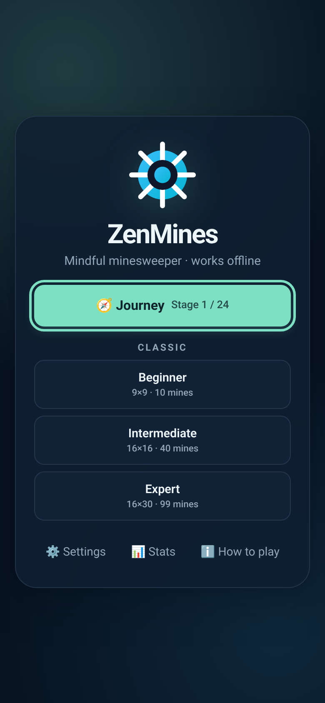
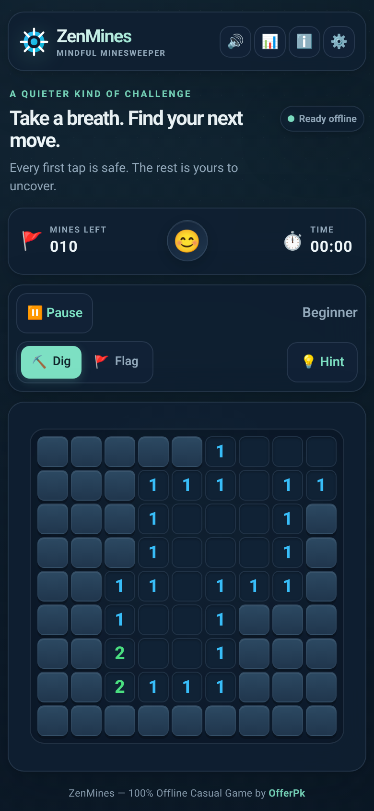
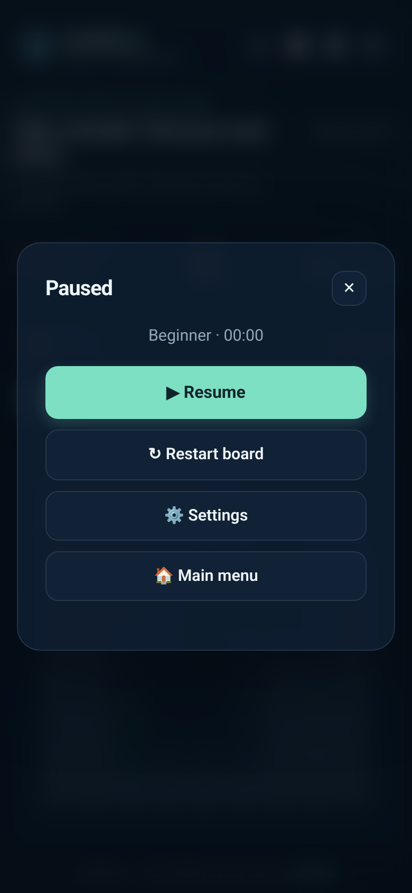
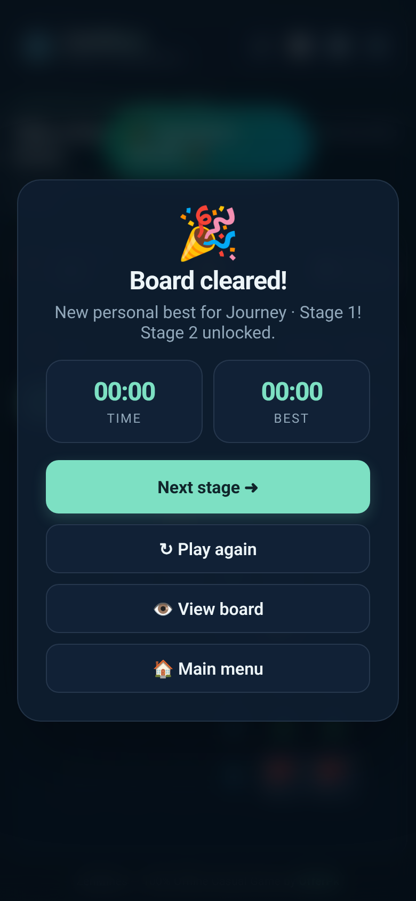
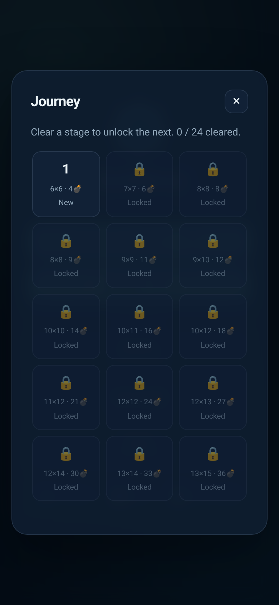
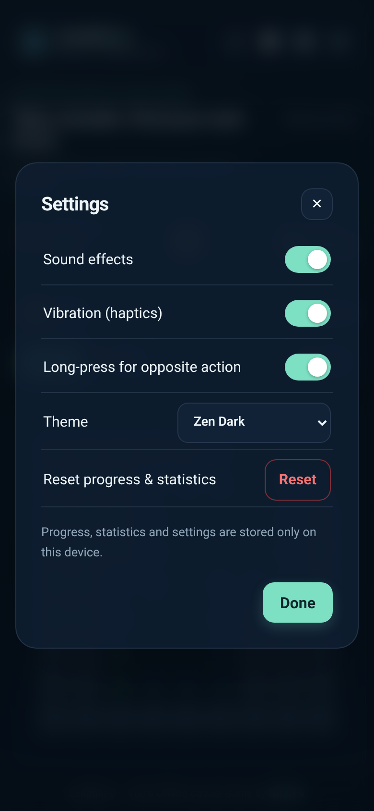
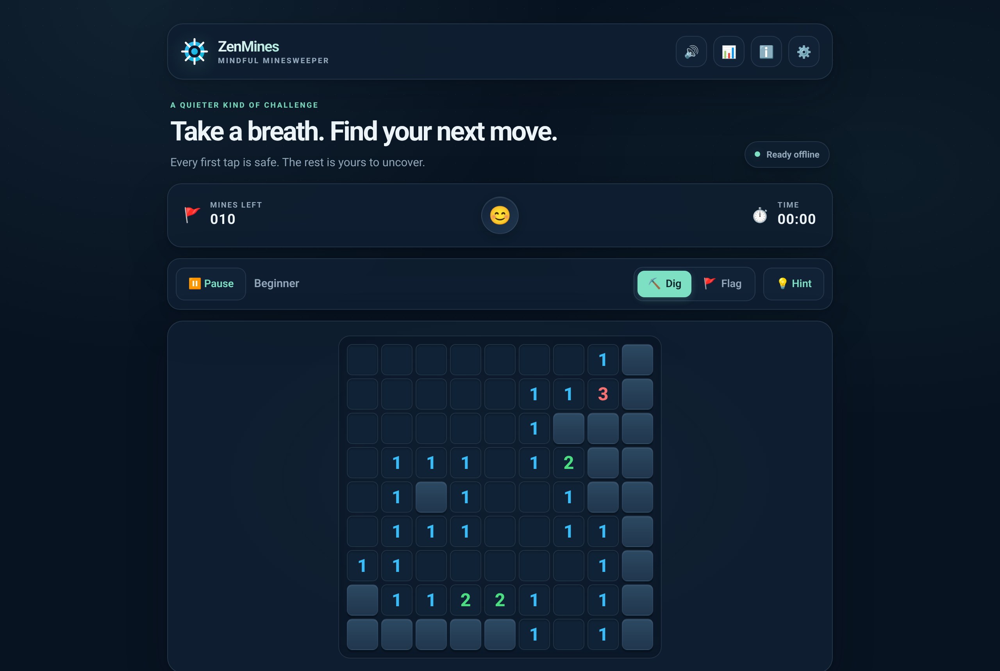

# ZenMines 💎💣

> A calm, modern, fully offline Minesweeper — Journey mode with 24 stages, three classic difficulties, pause & auto-save, procedural Web Audio sound effects, and a Capacitor Android build with AdMob (Google test IDs).

[](https://github.com/OfferPk/zenmines/actions/workflows/ci.yml)
[](https://offerpk.github.io/zenmines/)
[](https://github.com/OfferPk/zenmines/actions/workflows/android.yml)
[](LICENSE)

## 🌐 Live demo (GitHub Pages preview)

👉 **https://offerpk.github.io/zenmines/**

The demo is a static preview of `www/`. It works offline after the first load (service worker) and contains **no ads** — ads only appear inside the native Android app.

## 📸 Screenshots

| Main menu | Gameplay | Pause | Stage cleared |
| :---: | :---: | :---: | :---: |
|  |  |  |  |

| Journey stages | Settings | Desktop |
| :---: | :---: | :---: |
|  |  |  |

## ✨ Features

- **Main menu** with Continue (resumes your auto-saved board), Journey, Classic difficulties, Settings, Stats and How-to-play.
- **Journey mode** — 24 stages from 6×6 / 4 mines to 16×24 / 86 mines. Clearing a stage unlocks the next; best time per stage is saved.
- **Classic difficulties** — Beginner 9×9 (10), Intermediate 16×16 (40), Expert 16×30 (99) with best times.
- **Safe first tap** — your first dig and its 3×3 neighbourhood never hold a mine.
- **Controls** — Dig/Flag mode toggle, right-click to flag (mouse), long-press for the opposite action (touch, can be disabled), tap a satisfied number to chord. Keyboard: `P`/`Esc` pause, `F` toggles flag mode.
- **Pause** — pause button, `Esc`, Android back button, or switching apps pauses the clock and hides the board.
- **Game over / win dialog** — time, best time, Next stage, Play again, View board, Main menu.
- **Hints** — a logic helper highlights a square that is certainly safe or certainly a mine.
- **Settings** — sound effects, vibration, long-press, theme (Zen Dark / Paper Light / Neon Pulse), reset progress (two-tap confirm).
- **Sound** — all effects synthesised on-device with the Web Audio API (no audio files, no CDN); quick mute button in the header.
- **Progress in localStorage** — stats, streaks, best times, Journey unlocks, settings and the in-progress board.
- **Responsive** — phones (portrait), tablets and desktop; large boards scroll inside the board panel.
- **AdMob (Android only)** — adaptive banner + an interstitial every 3rd finished game, using **Google's public test IDs only**.

## 🗂 Project layout

```
src/            # source web app (edit here)
  index.html  style.css  game.js (UI/controller)  logic.js (pure rules)  audio.js  ads.js  sw.js
www/            # built web app (copied from src/ by `npm run build`; served by Pages and Capacitor)
android/        # Capacitor Android project (committed)
test/           # logic unit tests + headless browser smoke test
scripts/        # build + icon generation
```

## 🛠 Run locally

Requirements: Node.js ≥ 20.

```bash
git clone https://github.com/OfferPk/zenmines.git
cd zenmines
npm install
npm run build        # copies src/ -> www/
npm run serve        # http://localhost:8080  (or: cd www && python3 -m http.server 8080)
npm test             # logic unit tests
npm run smoke        # headless Chrome smoke test (needs Chrome/Chromium; set CHROME_PATH if not in /usr/bin)
```

You can also open `www/index.html` directly in a browser (the service worker is skipped on `file://`).

## 📱 Build the Android APK

Requirements: Node.js ≥ 20, JDK 21, Android SDK (API 36) — Android Studio installs both.

```bash
npm install
npm run cap:sync        # build web assets + npx cap sync android
npm run android:build   # cap:sync + ./gradlew assembleDebug
```

Debug APK: `android/app/build/outputs/apk/debug/app-debug.apk`. Open the project in Android Studio with `npx cap open android` if you prefer.

For a Play Store bundle run `npm run android:release` (`./gradlew bundleRelease`) after configuring your own signing key in `android/app/build.gradle` / `~/.gradle/gradle.properties` (never commit keystores or passwords).

CI: every push to `main` builds a debug APK in the **Android build** workflow (artifact `zenmines-apk`). Pushing a `v*` tag attaches the APK to a GitHub Release.

### AdMob IDs

This repo ships **Google sample test IDs only**:

| What | Test ID | Where |
| --- | --- | --- |
| App ID | `ca-app-pub-3940256099942544~3347511713` | `android/app/src/main/res/values/strings.xml` (`admob_app_id`) |
| Banner | `ca-app-pub-3940256099942544/6300978111` | `src/ads.js` |
| Interstitial | `ca-app-pub-3940256099942544/1033173712` | `src/ads.js` |

Before a real store release, replace them with your own AdMob IDs in a private build and set `isTesting: false` in `src/ads.js`. Do not commit real publisher IDs. The web build never loads AdMob.

## 🚀 Deploy `www/` to your own static server

`www/` is a plain static site (HTML/CSS/JS, no server code). Build it, then copy it anywhere:

```bash
npm run build
# Example: copy to a Linux server running nginx
rsync -avz --delete www/ user@your-server:/var/www/zenmines/
```

Minimal nginx site:

```nginx
server {
  listen 80;
  server_name games.example.com;
  root /var/www/zenmines;
  index index.html;
  location / { try_files $uri $uri/ /index.html; }
  location = /sw.js { add_header Cache-Control "no-cache"; }
}
```

Apache, Caddy, Netlify, Cloudflare Pages or any shared host work the same way: upload the contents of `www/` to the web root (or a sub-folder — all paths are relative). Serve over HTTPS so the offline service worker can register.

## 📄 License

[MIT](LICENSE) © 2026 OfferPk.
